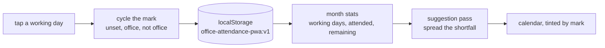

# Office Attendance PWA

Mobile-first Progressive Web App for tracking hybrid office days against a **60%** monthly target (Mon–Fri working days; no holidays in v1).

## What it does

- Month calendar with previous/next navigation
- Tap a working day to cycle **Unset → Office → Not office → Clear** (or use the picker)
- Stats for the viewed month:
  - Working days
  - Minimum for 60% (`Math.ceil(0.6 × workingDays)`)
  - Attended (office days)
  - Still needed
  - Status: **Behind** / **On track** / **Done**
  - Evenly spaced **suggested** future unmarked working days to cover the remaining need
- Confirmed office days and suggestions use distinct colors
- Persists in `localStorage` under `office-attendance-pwa:v1` (dates as `YYYY-MM-DD`)
- Installable PWA (manifest, icons, service worker, standalone, theme color); works offline after first load

## How it works



The target is `ceil(0.6 × working days in the month)`, computed locally, and Monday to Friday minus
holidays is the working-day set. Public holidays are not modelled in v1, which is why the app
shows the working-day count it used rather than hiding it.

The suggestion pass is the only part with an opinion. Given a shortfall of R days and a candidate
list of C unmarked working days from today onward, it places the picks at even fractional
positions along the list, `round(i × (C − 1) / (R − 1))`, and falls back to the midpoint when only
one day is needed. If some days are already marked office, the even slots are kept but ties are
broken toward the candidate farthest from any existing office day, so the app does not propose
three days in one week to fix a two-day deficit.

Everything lives in `localStorage`. There is no account, no server and no sync, so clearing site
data resets the month.

## Develop

```bash
npm install
npm run dev
```

Open the printed local URL (typically `http://localhost:5173`).

## Build

```bash
npm install
npm run build
```

Preview the production build:

```bash
npm run preview
```

## Install on your phone

Serve the app over **HTTPS** (or `localhost`) so the browser allows installation.

### From local / hosted URL

1. Run `npm run dev` (or deploy the `dist/` folder) and open the URL on your phone.
2. **iPhone (Safari):** Share → **Add to Home Screen**.
3. **Android (Chrome):** Menu ⋮ → **Install app** / **Add to Home screen**.

After install, open the home-screen icon for a standalone, offline-capable experience.

## Suggestion algorithm

Suggested days are chosen from today and future **unmarked** working days in the month. The app places the remaining needed count at even intervals along that candidate list, then greedily fills / refines to maximize spacing from existing office days (see comments in `src/lib/attendance.ts`).
